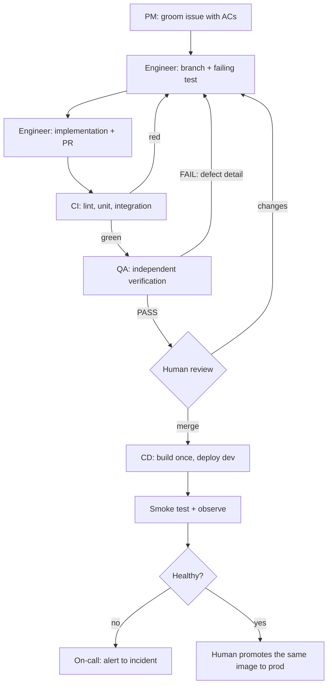

# Agent Team and Process

How work moves from an idea to a merged, deployed, observable change — with implementation and
verification done by different agents in different contexts.

The rule behind the whole design: **the agent that writes the code does not decide whether it is
correct.** Everything else follows from it.

## 1. The team

| Role | Responsibility | Owns | Does not do |
| --- | --- | --- | --- |
| **PM** | Groom tasks into ready issues with checkable acceptance criteria; keep the backlog ordered | `product-spec.md`, issue text, `_docs/backlog.md` | Write or review code |
| **Engineer** | Implement one groomed issue per branch/worktree: failing test first, smallest passing change | application code, unit tests, `openapi.yaml` for its slice | Merge, close issues, edit the spec |
| **QA** | Independently verify the ACs against the running code; write missing integration tests; verdict | `tests/integration/`, the PASS/FAIL comment | Modify product code |
| **On-call** | Respond to a fired alert: reproduce, diagnose, propose a bounded fix or escalate | `on-call-engineer/`, runbooks, incident records | Deploy, merge, hold prod credentials |
| **Human reviewer** | Merge, approve production promotion, disposition findings, resolve escalations | the merge button | Delegate the pass/fail decision to an agent |

Role definitions: [_docs/team/](team/) — `pm.md`, `software-engineer.md`, `qa-engineer.md`,
`on-call-engineer.md`. Discoverable subagent definitions live in `.agents/agents/*.md`; they are
plain Markdown, so any agent that reads `AGENTS.md` can use them. Each role runs in its own
session; context is `AGENTS.md` plus the one document its task needs, so a QA session never
inherits the engineer's assumptions.

## 2. Permissions

Enforced by what each role is given, not by what it is told.

| Capability | PM | Engineer | QA | On-call | Human |
| --- | --- | --- | --- | --- | --- |
| Read repo, spec, tracker | ✅ | ✅ | ✅ | ✅ | ✅ |
| Write spec / issues | ✅ | ❌ | ❌ | ❌ | ✅ |
| Write application code | ❌ | ✅ | ❌ | ✅ (isolated worktree, PR only) | ✅ |
| Write integration tests | ❌ | ⚠️ QA reviews them | ✅ | ❌ | ✅ |
| Run CI, run local stack | ✅ | ✅ | ✅ | ✅ | ✅ |
| Merge to `main` | ❌ | ❌ | ❌ | ❌ | ✅ |
| Deploy production | ❌ | ❌ | ❌ | ❌ | ✅ |
| Production credentials | ❌ | ❌ | ❌ | read-only, scoped, expiring | ✅ |

The on-call agent reasons over an evidence packet produced by allowlisted queries. Its only write
path is a PR against a throwaway branch.

## 3. Grooming

The cheapest place to fix a misunderstanding is before code exists.

A filed issue is a paragraph. The PM rewrites it with [_docs/task-template.md](task-template.md):
**Goal**, **Acceptance criteria**, **Out of scope**, **Constraints**. Acceptance criteria are
checkable — someone can point at the running app or a named test and say yes or no — and each one
names the AC id from `product-spec.md` it comes from.

Grooming is a gate, not a suggestion: an issue that is not groomed does not go to an engineer.
Anything the PM moves out of scope gets its own follow-up issue, linked from the original, so work
never silently disappears.

## 4. The loop

One issue per agent at a time; several agents may run at once on independent issues (§7). Two QA
cycles maximum, then a human decides.



The loop is bounded: `max_qa_cycles = 2`. A third failure escalates with both verdicts attached —
repeating a cycle that keeps failing is how agents burn an afternoon.

## 5. The QA verdict

QA posts one comment, in a fixed shape, on the issue. Fixed shape because it is also the evidence a
reviewer reads months later.

```markdown
## QA: FAIL

- [x] US1-AC1 A short line rejects the whole order — PASS
- [ ] US1-AC2 A successful order reserves every line — FAIL
      Order of 2 × SKU-A returned 201 with one reservation row

Tests: `make test-integration`, 22 passed, 1 failed
```

Rules: `PASS`/`FAIL` on the first line, every AC with a verdict, every failure with what was done
and what happened, the test command and its result, and no change to product code. QA may add
tests; fixing would end its independence.

## 6. The orchestrator

The main session is the orchestrator. It does not groom, implement, test or merge by hand — it
dispatches and enforces the process. This is the graph from
[Part 1 of the series](https://aishippingblog.com/p/ai-native-development-specifications), made
executable.

```
You are the orchestrator for this repository. You do not implement, groom or test yourself.

Lifecycle
1. Fill the free lanes from the eligible queue (up to 5 issues, §7). One issue per lane.
2. Launch the PM subagent to groom each issue. Do not skip this step.
3. Launch one software-engineer subagent per ready issue, each in its own worktree.
4. Launch a qa-engineer subagent per issue in a fresh context, with the issue and the diff only.
5. On FAIL, send the QA comment back to that engineer. Max 2 cycles, then escalate.
6. On PASS, leave the PR for the human merge gate. Close the issue only once the PR is merged.
7. As lanes free up, dispatch the next eligible issue; stop when the eligible backlog is empty.

Rules
- The engineer never closes an issue.
- QA never fixes code, only reports.
- The orchestrator never approves its own work and never merges.
- Merge one issue at a time, then rebase the remaining worktrees.
```

Run it with a goal rather than prompt by prompt — `/goal work through the backlog` — so the harness
resumes when an agent stops before the stop condition is met. The stop condition must be checkable:
"every `phase:2` issue has a PASS verdict and a merged PR", not "the backend is good".

## 7. Parallel execution

**Multiple agents can run at the same time.** The loop (§4) serialises work per issue; the graph runs
several independent issues concurrently, one git worktree per task, joined at a human merge gate.
The default ceiling is **five concurrent engineer worktrees** — the D5–D6 schedule assumes it — and
the orchestrator refills a freed lane from the eligible queue.

Work is parallelised only across **independent areas**.

```text
Phase 0    PM ─────────────────────────────────────────────► spec + groomed backlog (human approves)
Phase 1    Engineer(frontend prototype + mocked client) ──► openapi.yaml frozen from that client
             ├── Engineer(backend against the contract)   ─┐
             └── Engineer(CI + dev deploy)                ─┤ up to 5 worktrees in parallel
Phase 2    Engineer(domain + reserve) ──► QA ──► merge
Phase 3    Engineer(UI screens + real client) ──► QA ──► merge
Phase 4    Engineer(tests) ──► QA ──► merge
Phase 5    Engineer(containers + promotion gate) ──► QA ──► merge
Phase 6    Engineer(telemetry + alerts) ──► QA ──► merge
Phase 7    On-call(responder) ──► fire drill ──► human signs the incident record
Phase 8    PM(docs) + human(demo) ──► submit
```

Rules that make parallel work safe:

- One branch per issue, one worktree per agent. A shared checkout is where parallel agents corrupt
  each other's work.
- **File ownership.** Two agents never touch the same file in parallel. A task that must share a
  file is sequenced, not parallelised.
- The contract is frozen before backend and frontend proceed in parallel. After that, a shape change
  needs a PM-approved issue and a client regeneration.
- Keep the slots full while eligible work remains; do not start a task whose dependency is unmerged.
- The human merges, one issue at a time. Every join point is a merge, so there is always a
  reversible boundary.

## 8. Handoff artifacts

Nothing is communicated only "in the conversation" — each handoff is a file someone can re-read.

| From → To | Artifact | Where |
| --- | --- | --- |
| Human → PM | request / idea | issue comment, captured in the spec |
| PM → Engineer | groomed issue: goal, ACs, out of scope, constraints | tracker issue |
| Engineer → QA | PR with AC list, commands run, test output | pull request |
| QA → Engineer | verdict + a failing repro | issue comment |
| Engineer → Human | deploy record (image tag, env, migrations) | release notes |
| On-call → Human | incident record with evidence, action, verification | `on-call-engineer/incidents/<id>.md` |
| Anyone → anyone | what changed and how it was checked | `_docs/ai-usage-report.md` entry |

## 9. Evidence trail in the tracker

The rubric asks for a public tracker **and** evidence that agents used it. The chain is mechanical:

```text
issue #12 (groomed: goal, ACs, out of scope, constraints)
  → branch feat/12-atomic-reservation
  → commits referencing #12
  → PR "Closes #12" with AC checklist and test output
  → CI run link
  → QA verdict comment ("US1-AC1..AC5 PASS, tests/integration/test_reserve.py:41")
  → human merge
  → deployment record (image tag)
```

Board columns: `Backlog → Ready → In progress → In review → QA → Done`. `Ready` means groomed. WIP
limit: one card in progress per agent. Labels: `type:*`, `area:*`, `phase:*`, `size:S|M|L`.

## 10. Escalation

| Signal | Route |
| --- | --- |
| ACs ambiguous or contradictory | Back to the PM; the engineer stops, does not guess |
| QA fails twice on the same issue | Human reviews both verdicts and the diff; the scope is probably wrong |
| CI red for unrelated reasons | Fix the pipeline in its own PR; never skip or `.skip` a test |
| Deployment smoke test fails | Automatic rollback to the previous image tag; incident opened |
| Alert fires in production | On-call agent, bounded by `on-call-engineer/autonomy-policy.yaml` |
| Any agent request for prod credentials | Refused; human only |

## 11. Definition of done

Owned by the PR author, verified by QA, enforced by the human merge gate. The checklist lives in
[AGENTS.md §Definition of done](../AGENTS.md) so agents reading the entry point cannot miss it.

## 12. Known failure modes of this process

- **Agent self-approval.** If QA runs in the engineer's context it inherits its assumptions and
  agrees with itself. Mitigation: fresh session, criteria plus running code only.
- **Spec drift.** Code quietly becomes the spec. Mitigation: spec changes go through the PM and are
  reviewed in the PR that needs them.
- **Green-but-hollow tests.** Mitigation: every test is observed failing first; QA reverts the
  behaviour and confirms red.
- **Scope creep through "while I'm here".** Mitigation: one issue per PR, out-of-scope in the
  template, a follow-up issue for every good idea.
- **Orchestrator drift.** The orchestrator starts implementing "just this small part". Mitigation:
  it has no branch of its own; its output is dispatched work and merge order.
