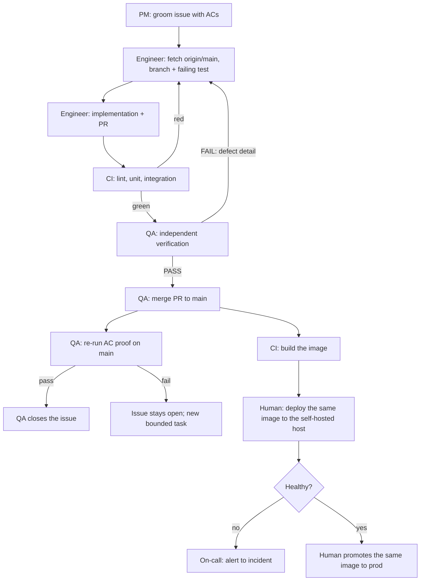

# Agent Team and Process

How work moves from an idea to a merged, deployed, observable change — with implementation and
verification done by different agents in different contexts.

The rule behind the whole design: **the agent that writes the code does not decide whether it is
correct.** Everything else follows from it.

## 1. The team

| Role               | Responsibility                                                                                                                      | Owns                                                                                         | Does not do                                      |
| ------------------ | ----------------------------------------------------------------------------------------------------------------------------------- | -------------------------------------------------------------------------------------------- | ------------------------------------------------ |
| **PM**             | Groom tasks into ready issues with checkable acceptance criteria; keep the backlog ordered                                          | `product-spec.md`, issue text, `_docs/backlog.md`                                            | Write or review code                             |
| **Engineer**       | Implement one groomed issue per branch/worktree from current `origin/main`: failing test first, smallest passing change             | application code, unit tests, `openapi.yaml` for its slice                                   | Merge, close issues, edit the spec               |
| **QA**             | Independently verify the ACs against the running code; write missing integration tests; verdict; merge after PASS; post-merge close | `tests/integration/`, the PASS/FAIL comment, the merge, the post-merge verdict and the close | Modify product code; merge without a posted PASS |
| **On-call**        | Respond to a fired alert: reproduce, diagnose, propose a bounded fix or escalate                                                    | `on-call-engineer/`, runbooks, incident records                                              | Deploy, merge, hold prod credentials             |
| **Human reviewer** | Approve the spec and contract, approve production promotion, disposition findings, resolve escalations                              | spec/contract, prod promotion, escalation decisions, the rubric                              | Delegate the pass/fail decision to an agent      |

Role definitions: [_docs/team/](team/) — `pm.md`, `software-engineer.md`, `qa-engineer.md`,
`on-call-engineer.md`. Discoverable subagent definitions live in `.agents/agents/*.md`; they are
plain Markdown, so any agent that reads `AGENTS.md` can use them. Each role runs in its own
session; context is `AGENTS.md` plus the one document its task needs, so a QA session never
inherits the engineer's assumptions.

## 2. Permissions

Enforced by what each role is given, not by what it is told.

| Capability                 | PM  | Engineer           | QA                                        | On-call                         | Human |
| -------------------------- | --- | ------------------ | ----------------------------------------- | ------------------------------- | ----- |
| Read repo, spec, tracker   | ✅  | ✅                 | ✅                                        | ✅                              | ✅    |
| Write spec / issues        | ✅  | ❌                 | ❌                                        | ❌                              | ✅    |
| Write application code     | ❌  | ✅                 | ❌                                        | ✅ (isolated worktree, PR only) | ✅    |
| Write integration tests    | ❌  | ⚠️ QA reviews them | ✅                                        | ❌                              | ✅    |
| Run CI, run local stack    | ✅  | ✅                 | ✅                                        | ✅                              | ✅    |
| Merge to `main`            | ❌  | ❌                 | ✅ (only after its own PASS and green CI) | ❌                              | ✅    |
| Close an issue after merge | ❌  | ❌                 | ✅ (only after the post-merge check)      | ❌                              | ✅    |
| Deploy production          | ❌  | ❌                 | ❌                                        | ❌                              | ✅    |
| Production credentials     | ❌  | ❌                 | ❌                                        | read-only, scoped, expiring     | ✅    |

The on-call agent reasons over an evidence packet produced by allowlisted queries. Its only write
path is a PR against a throwaway branch.

The QA agent is the only agent that merges. It merges only after it has posted `PASS` and CI is
green, one issue at a time. The orchestrator never merges and never approves its own work. A merge
runs CI and never deploys; deploying the built image to a self-hosted host is a human step, and
production promotion stays with the human (rule 8).

## 3. Grooming

The cheapest place to fix a misunderstanding is before code exists.

A filed issue is a paragraph. The PM rewrites it with [_docs/task-template.md](task-template.md):
**Goal**, **Acceptance criteria**, **Out of scope**, **Constraints**. Acceptance criteria are
checkable — someone can point at the running app or a named test and say yes or no — and each one
names the AC id from `product-spec.md` it comes from.

Grooming is a gate, not a suggestion: an issue that is not groomed does not go to an engineer.
Anything the PM moves out of scope gets its own follow-up issue, linked from the original, so work
never silently disappears.

## 4. The loop

One issue per agent at a time; several agents may run at once on independent issues (§7). Two QA
cycles maximum, then a human decides.



QA merges only after it has posted `PASS` and CI is green, then re-runs the proof on `main` at the
merge commit and closes the issue. A post-merge failure leaves it open and becomes a new bounded
task. The merge runs CI and does not deploy; deployment is a human step on the self-hosted host, and
production promotion remains the human's decision.

The loop is bounded: `max_qa_cycles = 2`. A third failure escalates with both verdicts attached —
repeating a cycle that keeps failing is how agents burn an afternoon.

## 5. The QA verdict

QA posts one comment, in a fixed shape, on the issue. Fixed shape because it is also the evidence a
reviewer reads months later.

```markdown
## QA: FAIL

- [x] US1-AC1 A short line rejects the whole order — PASS
- [ ] US1-AC2 A successful order reserves every line — FAIL
      Order of 2 × SKU-A returned 201 with one reservation row

Tests: `make test-integration`, 22 passed, 1 failed
```

Rules: `PASS`/`FAIL` on the first line, every AC with a verdict, every failure with what was done
and what happened, the test command and its result, and no change to product code. QA may add
tests; fixing would end its independence.

On `PASS`, QA performs the merge and the post-merge check in the same session:

1. Commit any integration test it added to the issue branch (tests only, never product code).
2. Rebase on current `main` — `git fetch origin && git rebase origin/main` — and re-run the AC proof
   on the rebased branch.
3. Make sure a PR exists with `Refs #N` (never `Closes`), and wait for green CI:
   `gh pr checks <n> --watch`.
4. Merge with `gh pr merge <n> --squash`, one issue at a time. Never merge on a failed proof or red
   CI.
5. Fetch `main` into a clean worktree at the merge commit and re-run the AC proof there.
6. Post the post-merge verdict and close the issue only if that proof passes.

```markdown
## QA: post-merge PASS

- [x] US1-AC1..AC5 re-checked at `763ad83` — PASS

Tests: `make test-integration`, 24 passed, 0 failed
Merged: #12 (squash) at `763ad83`
Closed: #12
```

QA closes the issue only after that check passes. If the merged state fails, the issue stays open
and the failure becomes a new bounded task; QA never closes before the merge and never pushes a fix
to `main`.

## 6. The orchestrator

The main session is the orchestrator. It does not groom, implement, test or merge by hand — it
dispatches and enforces the process. This is the graph from
[Part 1 of the series](https://aishippingblog.com/p/ai-native-development-specifications), made
executable.

```
You are the orchestrator for this repository. You do not implement, groom or test yourself.

Lifecycle
1. Fill the free lanes from the eligible queue (up to 5 issues, §7). One issue per lane.
2. Launch the PM subagent to groom each issue. Do not skip this step.
3. Launch one software-engineer subagent per ready issue, each in its own worktree branched from
   freshly fetched `origin/main`.
4. Launch a qa-engineer subagent per issue in a fresh context, with the issue and the diff only.
5. On FAIL, send the QA comment back to that engineer. Max 2 cycles, then escalate.
6. On PASS, QA merges the PR, re-checks `main` at the merge commit, posts the post-merge verdict,
   and closes the issue. The orchestrator does not merge.
7. After each merge, rebase the remaining worktrees on `origin/main`.
8. As lanes free up, dispatch the next eligible issue; stop when the eligible backlog is empty.

Rules
- The engineer never merges or closes an issue. QA merges only after its own PASS and green CI,
  then closes after the post-merge check.
- QA never fixes code, only reports and merges.
- The orchestrator never merges. It dispatches work, enforces a fresh `origin/main` base, and keeps
  lanes rebased after each merge.
- Merge one issue at a time, so every join point stays a reversible boundary.
```

Run it with a goal rather than prompt by prompt — `/goal work through the backlog` — so the harness
resumes when an agent stops before the stop condition is met. The stop condition must be checkable:
"every `phase:2` issue has a PASS verdict and a merged PR", not "the backend is good".

## 7. Parallel execution

**Multiple agents can run at the same time.** The loop (§4) serialises work per issue; the graph runs
several independent issues concurrently, one git worktree per task, joined at a serial QA merge
gate. The default ceiling is **five concurrent engineer worktrees** — the D5–D6 schedule assumes it
— and the orchestrator refills a freed lane from the eligible queue.

Work is parallelised only across **independent areas**.

```text
Phase 0    PM ─────────────────────────────────────────────► spec + groomed backlog (human approves)
Phase 1    Engineer(frontend prototype + mocked client) ──► openapi.yaml frozen from that client
             ├── Engineer(backend against the contract)   ─┐
             └── Engineer(CI + local compose)              ─┤ up to 5 worktrees in parallel
Phase 2    Engineer(domain + reserve) ──► QA ──► merge
Phase 3    Engineer(UI screens + real client) ──► QA ──► merge
Phase 4    Engineer(tests) ──► QA ──► merge
Phase 5    Engineer(containers + promotion gate) ──► QA ──► merge
Phase 6    Engineer(telemetry + alerts) ──► QA ──► merge
Phase 7    On-call(responder) ──► fire drill ──► human signs the incident record
Phase 8    PM(docs) + human(demo) ──► submit
```

Rules that make parallel work safe:

- One branch per issue, one worktree per agent, created from `origin/main` fetched at dispatch time.
  A shared checkout is where parallel agents corrupt each other's work.
- **File ownership.** Two agents never touch the same file in parallel. A task that must share a
  file is sequenced, not parallelised.
- The contract is frozen before backend and frontend proceed in parallel. After that, a shape change
  needs a PM-approved issue and a client regeneration.
- Keep the slots full while eligible work remains; do not start a task whose dependency is unmerged.
- QA merges, one issue at a time, after PASS and green CI. The orchestrator rebases the remaining
  worktrees on `origin/main` after each merge, and each engineer rebases before opening its PR.

## 8. Handoff artifacts

Nothing is communicated only "in the conversation" — each handoff is a file someone can re-read.

| From → To        | Artifact                                            | Where                                |
| ---------------- | --------------------------------------------------- | ------------------------------------ |
| Human → PM       | request / idea                                      | issue comment, captured in the spec  |
| PM → Engineer    | groomed issue: goal, ACs, out of scope, constraints | tracker issue                        |
| Engineer → QA    | PR rebased on `origin/main`, with AC list and tests | pull request                         |
| QA → Engineer    | verdict + a failing repro                           | issue comment                        |
| QA → `main`      | squash merge of the issue PR after PASS and CI      | pull request                         |
| QA → Human       | post-merge verdict and the closed issue             | issue comment                        |
| Engineer → Human | deploy record (image tag, env, migrations)          | release notes                        |
| On-call → Human  | incident record with evidence, action, verification | `on-call-engineer/incidents/<id>.md` |
| Anyone → anyone  | what changed and how it was checked                 | `_docs/ai-usage-report.md` entry     |

## 9. Evidence trail in the tracker

The rubric asks for a public tracker **and** evidence that agents used it. The chain is mechanical:

```text
issue #12 (groomed: goal, ACs, out of scope, constraints)
  → branch feat/12-atomic-reservation from current origin/main
  → commits referencing #12
  → PR "Refs #12" with AC checklist and test output
  → CI run link
  → QA verdict comment ("US1-AC1..AC5 PASS, tests/integration/test_reserve.py:41")
  → QA squash-merges the PR to main
  → QA post-merge re-check on main at the merge commit
  → issue closed by QA
  → deployment record (image tag)
```

Board columns: `Backlog → Ready → In progress → In review → QA → Done`. `Ready` means groomed. WIP
limit: one card in progress per agent. Labels: `type:*`, `area:*`, `phase:*`, `size:S|M|L`.

## 10. Escalation

| Signal                                 | Route                                                                 |
| -------------------------------------- | --------------------------------------------------------------------- |
| ACs ambiguous or contradictory         | Back to the PM; the engineer stops, does not guess                    |
| QA fails twice on the same issue       | Human reviews both verdicts and the diff; the scope is probably wrong |
| CI red for unrelated reasons           | Fix the pipeline in its own PR; never skip or `.skip` a test          |
| Deployment smoke test fails            | Automatic rollback to the previous image tag; incident opened         |
| Alert fires in production              | On-call agent, bounded by `on-call-engineer/autonomy-policy.yaml`     |
| Any agent request for prod credentials | Refused; human only                                                   |

## 11. Definition of done

Owned by the PR author, verified by QA, enforced by the QA merge gate. The checklist lives in
[AGENTS.md §Definition of done](../AGENTS.md) so agents reading the entry point cannot miss it.

## 12. Known failure modes of this process

- **Agent self-approval.** If QA runs in the engineer's context it inherits its assumptions and
  agrees with itself. Mitigation: fresh session, criteria plus running code only.
- **Judge and merger in one role.** QA passes and merges. Mitigation: the merge is mechanical and
  allowed only after a posted `PASS`, green CI and a rebased proof; the post-merge re-check runs in
  a clean worktree against `main`, and a failure leaves the issue open.
- **Spec drift.** Code quietly becomes the spec. Mitigation: spec changes go through the PM and are
  reviewed in the PR that needs them.
- **Green-but-hollow tests.** Mitigation: every test is observed failing first; QA reverts the
  behaviour and confirms red.
- **Scope creep through "while I'm here".** Mitigation: one issue per PR, out-of-scope in the
  template, a follow-up issue for every good idea.
- **Orchestrator drift.** The orchestrator starts implementing "just this small part". Mitigation:
  it has no branch of its own; its output is dispatched work and merge order.
