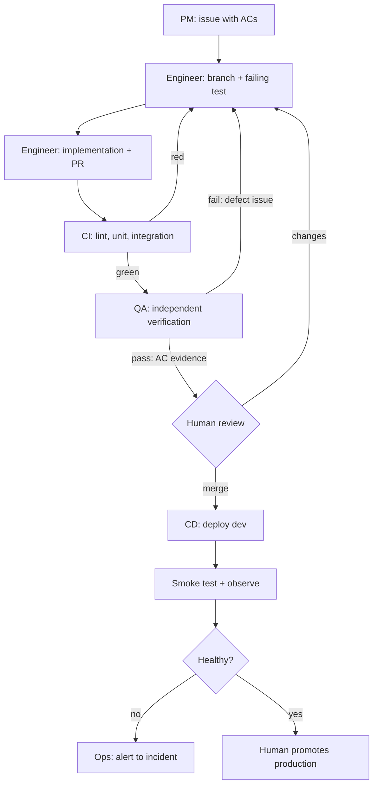

# Agent Team and Process

How work moves from an idea to a merged, deployed, observable change — with the implementation and
the verification done by different agents.

The rule behind the whole design: **the agent that writes the code does not decide whether it is
correct.** Everything else follows from that.

## 1. The team

| Role | Responsibility | Owns | Does not do |
| --- | --- | --- | --- |
| **PM** | Turn requests into spec deltas and tracker issues with acceptance criteria; keep the backlog groomed and ordered | `product-spec.md`, `docs/backlog.md`, issue text | Write or review code |
| **Engineer** | Implement one issue per branch: failing test first, then the smallest passing change | application code, unit tests, `openapi.yaml` for its slice | Merge, edit the spec, approve its own work |
| **QA** | Independently verify an issue's ACs against the diff; write and run integration tests; file defects | `tests/integration/`, QA verdicts, defect issues | Modify product code (that would end its independence) |
| **Ops / Responder** | On-call: consume an alert, assemble an evidence packet, diagnose, propose a bounded fix | `incident-response/`, runbooks, incident records | Deploy to production, merge, hold standing prod credentials |
| **Reviewer (human)** | Merge, approve production deploys, disposition security findings, resolve escalations | the merge button | Delegate the pass/fail decision to an agent |

Roles are implemented as subagent definitions plus the prompts in `docs/`; the human reviewer is
the only standing human gate. Context management for each role is `AGENTS.md` → the one doc
relevant to the task, so a QA session never inherits the engineer's reasoning.

## 2. Permissions

Enforced by what each role is given, not by what it is told.

| Capability | PM | Engineer | QA | Ops | Human |
| --- | --- | --- | --- | --- | --- |
| Read repo, spec, tracker | ✅ | ✅ | ✅ | ✅ | ✅ |
| Write spec / issues | ✅ | ❌ | ❌ | ❌ | ✅ |
| Write application code | ❌ | ✅ | ❌ | ✅ (isolated worktree, PR only) | ✅ |
| Write integration tests | ❌ | ⚠️ (must be reviewed by QA) | ✅ | ❌ | ✅ |
| Run CI, run local stack | ✅ | ✅ | ✅ | ✅ | ✅ |
| Merge to `main` | ❌ | ❌ | ❌ | ❌ | ✅ |
| Deploy production | ❌ | ❌ | ❌ | ❌ | ✅ |
| Production credentials | ❌ | ❌ | ❌ | read-only, scoped, expiring | ✅ |

The responder gets read-only observability access and no database credentials: it reasons over an
evidence packet produced by allowlisted queries, and its only write path is a PR against a
throwaway branch.

## 3. The loop

One issue at a time. Two QA cycles maximum, then a human decides.



The loop is bounded: `max_qa_cycles = 2`. A third failure escalates with both verdicts attached —
repeating a cycle that keeps failing is how agents burn an afternoon.

## 4. The graph

Loops run one task; the graph runs several in parallel. Work is parallelised only across
**independent areas**, with a human merge gate as the join point.

```text
Phase 0    PM ──────────────────────────────────────────────► spec + backlog (human approves)
Phase 1    Engineer(contract) ──► frozen openapi.yaml
              ├── Engineer(backend skeleton)     ─┐
              └── Engineer(frontend skeleton)    ─┤ parallel worktrees, one branch each
Phase 2    Engineer(domain+reserve) ──► QA ──► merge
Phase 3    Engineer(UI screens) ──► QA ──► merge        (parallel with Phase 5 infra)
Phase 4    Engineer(tests) ──► QA ──► merge
Phase 5    Engineer(containers+CI) ──► QA ──► merge
Phase 6    Engineer(telemetry+alerts) ──► QA ──► merge
Phase 7    Ops(responder) ──► fire drill ──► human signs off the incident record
Phase 8    PM(docs) + human(demo recording) ──► submit
```

Rules that make the graph safe:

- One branch per issue, one worktree per agent — a shared checkout is where parallel agents corrupt
  each other's work.
- The contract is frozen before backend and frontend work start in parallel; after that, a shape
  change requires a PM-approved issue and a client regeneration.
- No two agents touch the same file in parallel. If a task needs a shared file, it is sequenced.
- The human merges. Every join point is a merge, so there is always a reversible boundary.

## 5. Handoff artifacts

Nothing is communicated "in the conversation" — each handoff is a file someone can re-read later.
That is what makes the process auditable.

| From → To | Artifact | Where |
| --- | --- | --- |
| Human → PM | request / idea | issue comment or chat, captured in spec |
| PM → Engineer | issue with AC ids, out-of-scope note | tracker issue |
| Engineer → QA | PR with AC list, commands run, test output | pull request |
| QA → Engineer | verdict + defect issue with a failing repro | PR comment / new issue |
| Engineer → Ops | deploy record (SHA, env, migrations) | GitHub Deployment / release notes |
| Ops → Human | incident record with evidence, action, verification | `incident-response/incidents/<id>.md` |
| Anyone → anyone | "what changed and how I checked it" | `docs/ai-usage-report.md` entry |

## 6. Evidence trail in the tracker

The rubric asks for a public tracker **and** evidence that agents used it. The chain is complete
and mechanical:

```text
issue #12 (ACs, size, area label)
  → branch feat/12-atomic-reservation
  → commits referencing #12
  → PR "Closes #12" with AC checklist and test output
  → CI run link
  → QA verdict comment ("US1-AC1..AC5 verified, see tests/integration/test_reserve.py:41")
  → human merge
  → deployment record
```

Board columns: `Backlog → Ready → In progress → In review → QA → Done`. WIP limit: one card per
agent in progress. Labels: `type:*`, `area:*`, `phase:*`, `size:S|M|L`.

## 7. Escalation

| Signal | Route |
| --- | --- |
| ACs ambiguous or contradictory | PM rewrites the issue; engineer stops, does not guess |
| QA fails twice on the same issue | Human reviews both verdicts and the diff; scope is probably wrong |
| CI red for reasons unrelated to the change | Fix the pipeline in its own PR; never skip or `.skip` a test |
| Deployment smoke test fails | Automatic rollback to previous release; incident opened |
| Alert fires in production | Ops responder, bounded by `incident-response/autonomy-policy.yaml` |
| Any request for prod credentials by an agent | Refused; human only |

## 8. Definition of done

Owned by the PR author, verified by QA, enforced by the human merge gate — the checklist lives in
[AGENTS.md §Definition of done](../AGENTS.md#definition-of-done) so agents reading the entry point
cannot miss it.

## 9. Known failure modes of this process

- **Agent self-approval.** If QA runs in the engineer's context it inherits its assumptions and
  agrees with itself. Mitigation: fresh session, spec + diff only.
- **Spec drift.** Code quietly becomes the spec. Mitigation: spec changes go through PM and are
  reviewed in the PR that needs them, not after.
- **Green-but-hollow tests.** A test that passes without the behaviour. Mitigation: each test must
  be observed failing first; QA reverts the behaviour locally and confirms red.
- **Scope creep through "while I'm here".** Mitigation: one issue per PR, non-goals in the spec,
  and a backlog for good ideas rather than a bigger diff.
