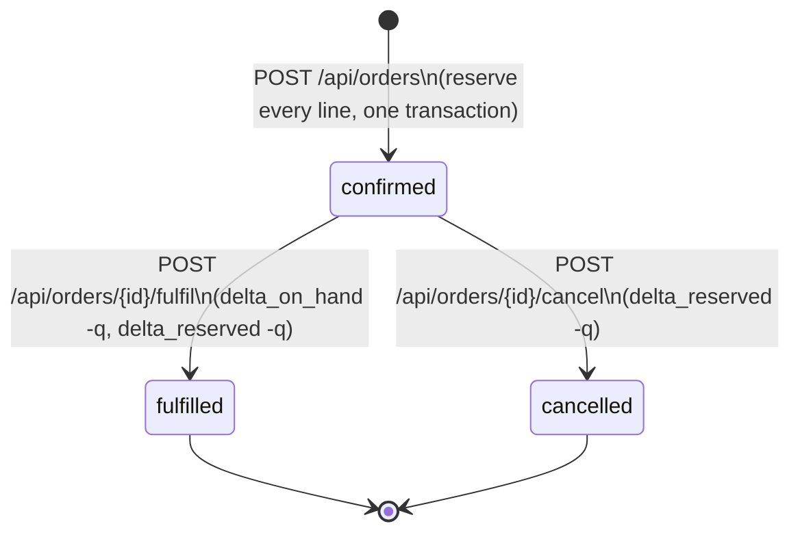

# Stockroom — Product Specification

| | |
| --- | --- |
| Version | 0.1 |
| Status | Draft — approved for build |
| Owner | Product manager agent (human review: Raymond) |
| Last updated | 2026-10-27 |
| Related | [_docs/domain.md](_docs/domain.md) · [_docs/backlog.md](_docs/backlog.md) · `openapi.yaml` (P1) |

This document describes **what the system does and how we know it works**. It is the source of
acceptance criteria: every task in the backlog cites at least one AC id, and every AC has a test
that fails without the behaviour. Schema and locking mechanics live in
[_docs/domain.md](_docs/domain.md).

---

## 1. Problem

A single-warehouse distributor sells from stock that is tracked in a shared spreadsheet. Three
failures follow, and they are the reason this system exists:

1. **Overselling.** Availability in the sheet is a stale number. Two order-desk staff can promise
   the same unit in the same minute; the warehouse discovers it at pick time.
2. **Unexplained counts.** When the physical count and the sheet disagree, the sheet has no
   history — only a total. Finding the cause means reconstructing the week from memory and chat.
3. **No reservation concept.** "Sold" and "shipped" are the same cell. Stock that is promised but
   not yet dispatched is invisible, so it is sold again.

The system must make three things true: a promise on stock cannot be broken by a concurrent
promise, a quantity change is always attributable to a reason and a person, and the count at any
moment is reproducible from history.

## 2. Users

| Persona | Does | Cares about |
| --- | --- | --- |
| **Order desk** (primary) | Places orders for customers, checks availability before promising a date | Fast, unambiguous answers: can I sell 3 of SKU-1042, yes or no |
| **Warehouse operator** | Receives deliveries, writes off damaged stock, marks orders dispatched | Recording reality quickly, with a reason that survives an audit |
| **Owner** | Glances at the dashboard, investigates a bad week | Low stock before it blocks a sale; stock that cannot go negative |

Authentication is a non-goal (§8); all personas share the single demo session, and every
movement records `actor` from a configured operator name.

## 3. Scope

**In scope for v1** — six user stories (§6):

| Id | Story | Why it earns its place |
| --- | --- | --- |
| US1 | Place an order that reserves stock atomically | Core transaction; the whole system's reason for existing |
| US2 | Survive concurrent orders for the same stock | The failure the spreadsheet causes; hardest correctness guarantee |
| US3 | Cancel an order and release its stock | Proves reservation is reversible and the ledger stays balanced |
| US4 | Fulfil an order and move stock out | Closes the lifecycle; proves `reserved` and `on_hand` move together |
| US5 | Receive and adjust stock with a reason | Written-off stock is how counts drift; needs an audit trail |
| US6 | See low stock and explain any count | Turns the ledger into something an operator can use |

**Stretch, only if Phase 5 finishes early:** idempotent order creation
(`Idempotency-Key`), multi-warehouse support, and a load-test report. Tracked as S1–S3 in the
backlog, not committed.

## 4. Domain rules

These are invariants, not guidelines. The system must never violate them; tests assert them and
the application checks them at runtime via `/api/invariants`.

| Id | Rule |
| --- | --- |
| I1 | `on_hand >= 0`, `reserved >= 0`, and `reserved <= on_hand` for every SKU |
| I2 | `stock.on_hand` equals the sum of `delta_on_hand` over all movements for that SKU |
| I3 | `stock.reserved` equals the sum of `delta_reserved` over all movements for that SKU |
| I4 | Movements are append-only: no update, no delete, no exception |
| I5 | A `confirmed` order has exactly one `reserve` movement per line, with `delta_reserved = +qty` |
| I6 | An order is created and reserved inside a single database transaction: no order exists in a partially reserved state |

I2 and I3 make `stock` a **cache** and the ledger the truth. That is what makes drift detectable
rather than invisible.

## 5. Order lifecycle

All-or-nothing reservation removes the intermediate `pending` and `partially_reserved` states that
most inventory tutorials add. An order is born confirmed or not born at all.

| From | To | Trigger | Stock effect |
| --- | --- | --- | --- |
| — | `confirmed` | `POST /api/orders` | `reserved += qty` per line |
| `confirmed` | `cancelled` | `POST /api/orders/{id}/cancel` | `reserved -= qty` per line |
| `confirmed` | `fulfilled` | `POST /api/orders/{id}/fulfil` | `on_hand -= qty`, `reserved -= qty` per line |
| `cancelled` / `fulfilled` | — | any transition | `409 invalid_transition`, no stock change |

## 6. User stories and acceptance criteria

Test tags: `unit` (domain logic, no database), `integration` (HTTP + real Postgres), `e2e`
(Playwright). Every AC below becomes at least one test.

### US1 — Place an order that reserves stock atomically

As order desk staff, I want an order to reserve stock for all of its lines at once, so that a
customer is never promised goods I cannot ship.

- **US1-AC1** *Short line rejects the whole order.* Given SKU-A has 5 available and SKU-B has 0,
  when I submit an order of 2 × SKU-A and 1 × SKU-B, then the response is `409` with
  `type: insufficient_stock` and a per-line detail listing SKU-B as short by 1; SKU-A's
  `reserved` is unchanged and no order row exists. `integration`
- **US1-AC2** *Successful order reserves every line.* Given all lines are available, when I submit,
  then the response is `201` with status `confirmed`, available drops by the ordered quantity for
  each line, and one `reserve` movement per line is written. `integration`
- **US1-AC3** *Prices are snapshotted.* When I place an order, then each line stores the unit price
  at that moment; changing the product price afterwards does not change the order. `unit`
- **US1-AC4** *Invalid quantities are rejected.* Quantities of zero or less return `422` and
  reserve nothing. `unit` + `integration`
- **US1-AC5** *Unknown SKU is a client error.* Ordering a SKU that does not exist returns `422`
  naming the SKU, not a `500`. `integration`

### US2 — Survive concurrent orders for the same stock

As the owner, I want the system to refuse to sell stock twice when two orders arrive at the same
instant, so that overselling is impossible rather than unlikely.

- **US2-AC1** *One winner.* Given SKU-A has exactly 1 available, when 20 orders for 1 unit are
  submitted simultaneously, then exactly one returns `201`, nineteen return `409`, `reserved`
  equals 1, and available equals 0. `integration`
- **US2-AC2** *No 500s and no deadlocks under contention.* Repeated 20-way contention runs return
  only `201`/`409` — never `500`, never a surfaced deadlock error — over 50 consecutive runs.
  `integration`
- **US2-AC3** *Multi-line contention leaves no partial reservation.* When 10 concurrent orders
  overlap on two SKUs in different orders, then every accepted order holds both lines and every
  rejected order holds neither. `integration`

### US3 — Cancel an order and release its stock

As order desk staff, I want to cancel an order and have the stock immediately available again, so
that abandoned orders do not lock inventory.

- **US3-AC1** *Cancel releases.* Given a `confirmed` order, when I cancel it, then status is
  `cancelled`, one `release` movement per line is written, and available returns to its prior
  value. `integration`
- **US3-AC2** *Cancel is not idempotent by accident.* Cancelling an already cancelled order returns
  `409 invalid_transition` and writes no movement (no double release). `unit` + `integration`
- **US3-AC3** *Fulfilled orders cannot be cancelled.* Cancelling a `fulfilled` order returns `409`
  and changes no stock. `integration`

### US4 — Fulfil an order

As the warehouse operator, I want to mark an order dispatched, so that on-hand stock reflects what
physically left the shelf.

- **US4-AC1** *Fulfil moves both counters.* When I fulfil a `confirmed` order, then `on_hand`
  decreases by each line quantity, `reserved` decreases by the same amount, one `ship` movement per
  line is written, and the order becomes `fulfilled`. `integration`
- **US4-AC2** *Availability is unchanged by fulfilment.* Available (`on_hand - reserved`) is the
  same before and after fulfilling an order — the goods were already promised. `unit`
- **US4-AC3** *Cancelled orders cannot be fulfilled.* Returns `409 invalid_transition`. `unit`

### US5 — Receive and adjust stock, with a reason

As the warehouse operator, I want to receive deliveries and write off damaged stock with a reason
and a note, so that every count difference has an explanation.

- **US5-AC1** *Receive increases on-hand.* When I receive 10 units of SKU-A with a note, then
  `on_hand` increases by 10, available increases by 10, and a `receive` movement records the actor
  and note. `integration`
- **US5-AC2** *Adjust cannot break reservations.* When I adjust SKU-A by an amount that would make
  `on_hand < reserved`, then the request returns `409 would_breach_reserved`, no movement is
  written, and the counts are unchanged. `integration`
- **US5-AC3** *Adjust cannot go negative.* An adjustment below zero `on_hand` returns `409
  negative_on_hand`. `integration`
- **US5-AC4** *Reason is required.* `reason` is one of `receive|adjust|…`; a free-text `note` is
  required when the reason is `adjust`, and empty notes are rejected with `422`. `unit`
- **US5-AC5** *No mutation endpoints exist.* The API offers no `PUT`/`PATCH`/`DELETE` on movements.
  `integration` (contract test)

### US6 — See low stock and explain any count

As order desk staff, I want to see which SKUs are running out and how a count got to its current
value, so that I can act before a sale fails and answer "why does the sheet say 7?".

- **US6-AC1** *Low stock is relative to the reorder point.* The inventory list marks a SKU `low`
  when `available <= reorder_point`, and the badge disappears once stock is received. `unit` + `e2e`
- **US6-AC2** *Audit trail is complete and ordered.* `GET /api/stock/{sku}/movements` returns
  movements newest first with reason, actor, note, order reference and the running `on_hand`
  balance after each entry. `integration`
- **US6-AC3** *Invariants are reportable, not hidden.* `GET /api/invariants` returns `200` with
  `ok: true` on a healthy database, and `200` with the violated rule ids and affected SKUs when a
  row has been corrupted. It never returns `500` — a check that crashes is not a check.
  `integration`
- **US6-AC4** *Explain a count from the UI.* From the inventory table I can open a SKU and read its
  movement history without leaving the page. `e2e`

## 7. API surface

The contract lives in `openapi.yaml` (Phase 1) and is authoritative for request and response
shapes. Summary:

| Method | Path | Purpose | Success | Errors |
| --- | --- | --- | --- | --- |
| `GET` | `/api/products` | Products with availability and `low` flag | `200` | — |
| `GET` | `/api/stock` | Stock rows: on-hand, reserved, available, reorder point | `200` | — |
| `POST` | `/api/stock/receive` | Receive a delivery | `201` | `422` |
| `POST` | `/api/stock/adjust` | Adjust stock with a reason and note | `201` | `409`, `422` |
| `GET` | `/api/stock/{sku}/movements` | Audit trail for one SKU | `200` | `404` |
| `POST` | `/api/orders` | Create an order and reserve stock | `201` | `409`, `422` |
| `GET` | `/api/orders` | List orders, filter by status | `200` | `422` |
| `GET` | `/api/orders/{id}` | Order with lines, reservations and movement timeline | `200` | `404` |
| `POST` | `/api/orders/{id}/cancel` | Cancel and release | `200` | `404`, `409` |
| `POST` | `/api/orders/{id}/fulfil` | Fulfil and ship | `200` | `404`, `409` |
| `GET` | `/api/invariants` | Invariant check report | `200` | — |
| `GET` | `/healthz` | Liveness + database reachability | `200` / `503` | — |
| `GET` | `/api/version` | Commit SHA and build time | `200` | — |

Conventions:

- **Errors** use `application/problem+json` (RFC 9457): `type`, `title`, `status`, `detail`,
  optional `errors[]` for per-line detail, and `trace_id` so a user-visible error can be found in
  the trace UI.
- **Money** is integer minor units (centavos), currency `PHP`. No floats anywhere.
- **Identifiers** are UUIDv7 for orders and movements; SKU is a human-readable string
  (`SKU-1042`, unique).
- **Time** is UTC ISO-8601 in responses; the UI renders in the viewer's timezone.
- **No customer PII in telemetry.** Orders carry a `customer_ref` (free text, e.g. `CUST-88`) that
  is allowed in logs; nothing else about the customer is stored beyond that reference.

## 8. Non-goals

| Excluded | Why |
| --- | --- |
| Authentication, users, roles | The rubric does not require it; the deployment is a public demo with seeded non-sensitive data. Adding auth would consume the time budgeted for observability. |
| Multiple warehouses | Schema keeps a `warehouse_id` foreign key with one seeded row so it can be added later, but v1 exposes a single location. |
| Payments, invoices, tax | Different problem; the order desk already has a payment system. |
| Purchase orders and suppliers | Receiving covers the warehouse's side; supplier workflow is a separate product. |
| Returns and refunds | A return is a `receive` with an `adjust` note in v1. A first-class return flow is out of scope. |
| Reservation expiry (timeouts) | Would require a scheduler and a second failure mode. All-or-nothing reservation at creation makes stranded holds unlikely. |
| Real-time multi-user updates, barcode scanning, mobile app | Not needed to demonstrate the correctness core. |

## 9. Open questions

| # | Question | Default if unanswered |
| --- | --- | --- |
| Q1 | Should `reorder_point` be per SKU or global? | Per SKU, seeded with a demo value |
| Q2 | Is `customer_ref` free text or a fixed set of demo customers? | Free text, validated to 3–40 chars |
| Q3 | Do we need partial fulfilment (ship 2 of 3)? | No — v1 fulfils the whole order; partial shipment is a v2 story |

## 10. Change log

| Version | Date | Change |
| --- | --- | --- |
| 0.1 | 2026-10-27 | Initial spec: six stories, invariants I1–I6, order lifecycle, API surface, non-goals |
